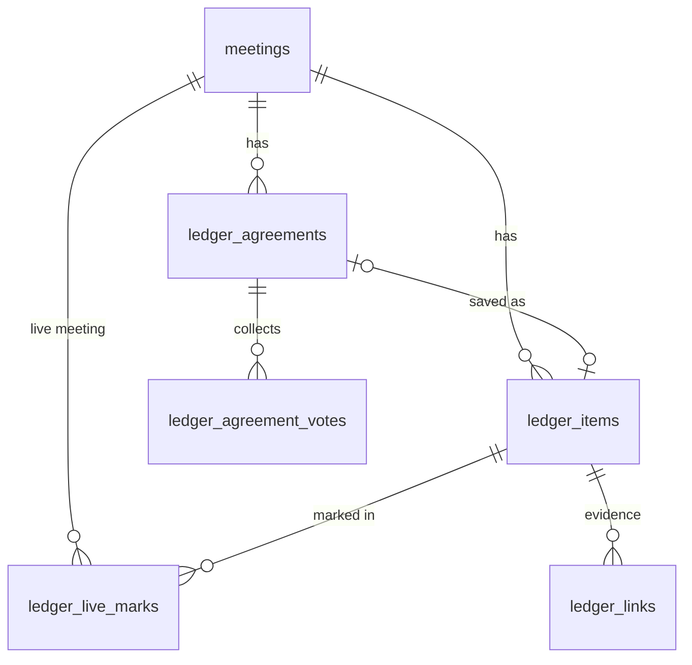

# 0002. Live Ledger

**Status**: In Progress
**Date**: 2026-11-02
**Mode**: FEATURE
**Scope feature**: [docs/scope/scope.md, row 18. Live Ledger](../../scope/scope.md)
**Workflow tier**: GA
**Build approach**: Extend, built as end to end slices
**Builds on**: [0001. Promise Ledger](../0001-promise-ledger/index.md)

## Summary

Live Ledger brings the Promise Ledger into the live call. You, the owner, open a small panel that lists your open and overdue promises from earlier meetings. You preview one, then show it to everyone as a quote card. While the card is up you mark it Kept, Still open, or Reversed. You can also type a decision and ask everyone to tap Agree or Not yet. When you close it, the result is saved to the ledger as "agreed by N of M".

Every card and every vote goes through a server route that checks who you are, and the server sends the Stream custom event (a small message Stream delivers to everyone in the call). Nobody in the call can fake a card. After the call, the existing ledger match uses your live marks as strong hints. If the transcript backs a mark up, the link is saved as confirmed with the real quote. If it does not, the mark stays visible as "marked live, no transcript evidence". No new provider, no new env var, no LLM call during the call, zero cost.

## Requirements

### User stories

- As a meeting owner, you want to see your open and overdue promises during a call, so you can follow up while everyone is there.
- As a meeting owner, you want to preview a card before everyone sees it, so you never put someone on the spot by mistake.
- As a participant (signed in or guest), you want to see the exact words that were promised, so the follow up is fair and clear.
- As a meeting owner, you want to mark a promise Kept, Still open, or Reversed in the moment, so the ledger reflects what the room agreed.
- As a meeting owner, you want a quick Agree or Not yet check on a decision, so the ledger records who actually agreed.
- As a participant who joins late, you want to see the card or agreement that is already up, so you are not left out.

### Acceptance criteria

- **AC-1 Check-in list.** `GET /api/ledger/live/checkin?callId=` returns up to 20 of your open items from your other meetings, overdue first (oldest due date first), then items with a due date (soonest first), then the newest. Each row has statement, quote, assignee, due date, derived status (`open` or `overdue`), and the source meeting title and date. No LLM and no embedding call.
- **AC-2 Owner only.** Check-in, card, and agreement routes return 401 when signed out and 404 when the signed in user does not own the meeting found by `stream_call_id`. Ownership is `meetings.user_id`, never the client's `call.state.createdBy`.
- **AC-3 Preview.** Clicking an item in the panel shows a preview of the exact card. Nothing is sent until you press "Show to everyone".
- **AC-4 Raise.** `POST /api/ledger/live/card` with `action: "raise"` stores a `ledger_live_marks` row (or reopens the existing one), closes any other open card for this meeting, and sends a `ledger.card` custom event. Every participant sees the quote card within about 2 seconds.
- **AC-5 Card wording.** An overdue item reads "Still open?" with the due date, never "Overdue" or any blaming word. The card shows the verbatim quote, the assignee, and the source meeting title.
- **AC-6 Live mark.** `action: "mark"` with `mark` of `kept`, `open`, or `reversed` stores the mark with `marked_at` and sends `ledger.card_mark`. Everyone sees the card change to the marked state. A later mark on the same item in the same meeting replaces the earlier one.
- **AC-7 Close.** `action: "close"` sets `closed_at` and sends `ledger.card_close`. The card disappears for everyone.
- **AC-8 Throttle.** A raise less than 1.5 seconds after the previous raise in the same meeting returns 429 and sends nothing.
- **AC-9 Agreement open.** `POST /api/ledger/live/agreement` with `action: "open"` and a decision of 1 to 280 characters creates a `ledger_agreements` row and sends `ledger.agreement_open`. Only one agreement can be open per meeting (409 otherwise).
- **AC-10 Vote.** `POST /api/ledger/live/vote` stores one vote per voter (`agree` or `not_yet`, changeable while open) and sends `ledger.agreement_tally` with the counts. Signed in callers vote as their Clerk id. Guests vote with their guest Stream token, verified by `verifyStreamUserToken`. A vote on a closed agreement returns 409.
- **AC-11 Agreement close.** `action: "close"` counts agree votes (N) and sets M to the larger of the votes cast and Stream's `total_participants` for the call. It writes a `ledger_items` row with `kind = 'decision'`, `source = 'live_agreement'`, `agreed_count = N`, `total_count = M`, the typed decision as both statement and quote, and an embedding. It sends `ledger.agreement_close`. If Stream's count fails, M is the votes cast and the failure is logged with `[live-ledger]`.
- **AC-12 Late join.** `GET /api/ledger/live?callId=` returns the open card (if any) and the open agreement (if any, with tallies and the caller's own vote). Any participant can call it: the owner, a signed in user with an `attendance_events` row for the meeting, or a guest whose Stream token verifies. Everyone else gets 403.
- **AC-13 Event size.** Every custom event payload is under 5 KB. Statement is cut to 300 characters and quote to 500 before sending. A helper refuses to send anything over 4.5 KB and logs it.
- **AC-14 Reconcile.** When `POST /api/ledger/match` runs on a meeting with live marks, items marked live are added to the candidate list even if similarity would leave them out. A verdict whose relation equals the live mark is stored as `confirmed` with `decided_at`, and the item status is recomputed. A verdict that disagrees stays `suggested`. A rejected link is never touched.
- **AC-15 Ledger tab.** The Ledger tab shows a "Marked live" badge on items and links that have a live mark, a "Marked live as kept, no transcript evidence found" line when no link backs the mark, and "Agreed live by N of M" (instead of a line number) on agreement items.
- **AC-16 Agreement items survive reprocessing.** Rerunning `/api/ai/process` on the meeting never deletes `source = 'live_agreement'` items.
- **AC-17 Room stays stable.** The panel and the card overlay render outside the participant tile tree and do not subscribe to participant arrays. The camera re render loop does not come back (verified in a live call).
- **AC-18 Zero cost.** Stream free tier custom events, one embedding per closed agreement, no LLM call during the call.

## Decision

Server sent Stream custom events (`video.sendCallEvent` from `@stream-io/node-sdk`, under the owner's user id) behind owner only Next.js routes, with live state stored in three new Supabase tables. Post call reconcile extends the existing `runLedgerMatch` instead of adding a second matcher. The check-in list is a plain deterministic query, no embedding.

Runner up: client side `call.sendCustomEvent`. It is simpler but anyone in the call with the `send-event` grant could send a fake card, and nothing would be stored for late joiners or reconcile.

## Feature design

### Data model

New tables, added to `supabase/schema.sql` in a `Live Ledger` section, RLS on with no policies, `service_role` grants, same as the ledger tables.

```sql
create table if not exists ledger_live_marks (
  id uuid primary key default gen_random_uuid(),
  meeting_id uuid references meetings(id) on delete cascade not null, -- the live meeting
  item_id uuid references ledger_items(id) on delete cascade not null, -- an item from an earlier meeting
  mark text check (mark in ('kept', 'open', 'reversed')),             -- null while raised, not marked
  raised_at timestamptz not null default now(),
  marked_at timestamptz,
  closed_at timestamptz,
  unique (meeting_id, item_id)
);
create index if not exists ledger_live_marks_meeting_idx on ledger_live_marks (meeting_id, raised_at desc);

create table if not exists ledger_agreements (
  id uuid primary key default gen_random_uuid(),
  meeting_id uuid references meetings(id) on delete cascade not null,
  statement text not null check (char_length(statement) between 1 and 280),
  status text not null default 'open' check (status in ('open', 'closed')),
  agreed_count integer,
  total_count integer,
  ledger_item_id uuid references ledger_items(id) on delete set null,
  opened_at timestamptz not null default now(),
  closed_at timestamptz
);
create unique index if not exists ledger_agreements_one_open
  on ledger_agreements (meeting_id) where status = 'open';

create table if not exists ledger_agreement_votes (
  agreement_id uuid references ledger_agreements(id) on delete cascade not null,
  voter_id text not null, -- Clerk id or verified Stream guest id
  vote text not null check (vote in ('agree', 'not_yet')),
  voted_at timestamptz not null default now(),
  primary key (agreement_id, voter_id)
);

alter table ledger_items
  add column if not exists source text not null default 'transcript'
    check (source in ('transcript', 'live_agreement')),
  add column if not exists agreed_count integer,
  add column if not exists total_count integer;
```



- The open card for a meeting is the `ledger_live_marks` row with `closed_at is null` and the latest `raised_at`. Raising a card sets `closed_at = now()` on any other open row for that meeting.
- An agreement item has `line_number = 0` and `quote = statement` (the exact text everyone saw). `quote_language`: Arabic script plus Latin letters gives `mixed`, Arabic script only gives `ur`, otherwise `en`.
- `writeLedgerItems` in `src/agent/ledger.ts` deletes only rows with `source = 'transcript'` (AC-16).

### API contracts (add to AGENTS.md before coding)

```
GET  /api/ledger/live/checkin   → owner only: ?callId=, up to 20 open/overdue items from the owner's other meetings (deterministic, no AI)
GET  /api/ledger/live           → participant: ?callId= (+ guestStreamToken for guests), open card + open agreement with tallies and the caller's vote
POST /api/ledger/live/card      → owner only: { callId, itemId, action: "raise" | "mark" | "close", mark? }, stores the live mark, sends a ledger.card* event
POST /api/ledger/live/agreement → owner only: { callId, action: "open" | "close", statement?, agreementId? }, close writes a decision ledger item "agreed by N of M"
POST /api/ledger/live/vote      → participant: { callId, agreementId, vote: "agree" | "not_yet", guestStreamToken? }, one vote per voter, sends a tally event
GET  /api/ledger                → (extended) items carry source, agreedCount, totalCount, liveMark
POST /api/ledger/match          → (extended) live marks join the candidates and a matching verdict is stored as confirmed
```

Error shape everywhere: `{ error: string }` with 400 (bad body), 401, 403, 404, 409, 429, 502 (Stream send failed after the row was written; the row stays, the client shows "Could not reach everyone, try again").

### Custom events

All sent by `sendLiveLedgerEvent(callId, ownerId, custom)` in `src/lib/live-ledger-events.ts` (server only), which wraps `StreamClient.video.sendCallEvent({ type: "default", id: callId, user_id: ownerId, custom })` and checks the JSON size first (AC-13).

```ts
type LiveLedgerEvent =
  | { event: "ledger.card"; itemId: string; statement: string; quote: string; assignee: string | null; dueDate: string | null; derivedStatus: "open" | "overdue"; sourceTitle: string }
  | { event: "ledger.card_mark"; itemId: string; mark: "kept" | "open" | "reversed" }
  | { event: "ledger.card_close"; itemId: string }
  | { event: "ledger.agreement_open"; agreementId: string; statement: string }
  | { event: "ledger.agreement_tally"; agreementId: string; agree: number; notYet: number }
  | { event: "ledger.agreement_close"; agreementId: string; agreed: number; total: number };
```

The type lives in `src/lib/live-ledger-types.ts` (shared, no secrets). The client listens with one `call.on("custom", ...)` in a `useLiveLedger(call)` hook and ignores events whose `custom.event` does not start with `ledger.`. Verified against `@stream-io/node-sdk` 0.7.3 (`VideoApi.sendCallEvent`, `SendCallEventRequest { user_id?, custom? }`) and `@stream-io/video-client` 1.57.0 (`CustomVideoEvent.custom`). Re verify via the `stream-react` skill before each slice, per the permanent Stream rule.

### Participant check

`resolveLiveCaller(callId, guestStreamToken?)` in `src/lib/live-ledger-auth.ts`:
1. Signed in: owner if `meetings.user_id` matches; else participant if an `attendance_events` row exists with that `meeting_id` and `user_id`.
2. Not signed in: `verifyStreamUserToken(token, callId)` returns the guest's Stream id.
3. Otherwise `null` (403). The client retries `GET /api/ledger/live` once after 3 seconds on 403, because the join attendance event can land a moment after the room mounts.

### Reconcile (inside `runLedgerMatch`)

1. Load this meeting's live marks with `mark in ('kept', 'reversed')`.
2. Add their items to the candidate list when missing (still only items the user owns from earlier meetings, status `open`).
3. After `filterVerdicts`, for each fresh match whose item has a live mark with the same relation, write `state: 'confirmed'` and `decided_at: now()`, then call `recomputeLedgerItemStatus`. Existing confirmed or rejected links stay locked (current rule).
4. `open` marks change nothing; they only show in the UI.

### UI

- `src/components/live-ledger/LiveLedgerPanel.tsx` (owner only): a side sheet opened from a new "Ledger" control in the owner control group. It holds the check-in list with a search filter, the card preview with "Show to everyone", the mark buttons for the open card, and an agreement composer with a live tally and Close. Loading uses `useLoadingTimeout` + `LoadError`.
- `src/components/live-ledger/LiveLedgerCard.tsx` (everyone): a quote card overlay near the top of the stage, above the tiles, with dismiss (local only). It shows the marked state when marked.
- `src/components/live-ledger/AgreementPrompt.tsx` (everyone): Agree and Not yet buttons, your vote highlighted, the tally, and the closed result "Agreed by N of M".
- All three are rendered by MeetingRoom as siblings of the layout, take only `call` plus plain props, and never read participant hooks. Meeting Room dark tokens only (`bg-inverse-surface`, `text-inverse-on-surface`, `bg-primary-container`, `text-on-primary`, `border-outline-variant`). No hex, no raw Tailwind colors.
- Ledger tab: badges per AC-15.

### Value sourcing

| Value | Source |
|---|---|
| Owner id, ownership | Clerk `auth()` + `meetings.user_id` by `stream_call_id` |
| Check-in items | `ledger_items` joined to `meetings` where `user_id` = owner, `status = 'open'`, `meeting_id` not this meeting |
| Derived status | `deriveLedgerStatus("open", due_date, today)` with `today` from the client query (`YYYY-MM-DD`), same as `GET /api/ledger` |
| Source meeting title | `meetings.title` of the item's meeting, "Untitled meeting" fallback |
| Voter id | Clerk id, or the Stream id returned by `verifyStreamUserToken` |
| N | count of `agree` votes at close |
| M | `max(votes cast, queryCallParticipants().total_participants)`; votes cast if Stream fails |
| Agreement embedding | `embedTexts([statement])` from `src/agent/embed.ts`; null on failure (logged, close still succeeds) |
| Event sender | the owner's Clerk id, which is their Stream user id |

### Critical test scenarios

- Non owner calls card, agreement, or checkin route: 404, no event sent.
- Raise twice within 1.5 seconds: second is 429.
- Raise item B while item A is open: A gets `closed_at`, one open card remains.
- Vote twice with different values: one row, latest value, tally right.
- Guest vote with a bad token: 403.
- Close with Stream participant query failing: M equals votes cast, logged.
- Event payload over 4.5 KB: not sent, route returns 502, row kept.
- Reprocess a meeting that has an agreement item: item still there.
- Match with a live `kept` mark and a `kept` verdict: link `confirmed`, item `kept`. With a `reversed` verdict: link `suggested`. With an existing rejected link: unchanged.
- Late joiner GET while a card and an agreement are open: both returned with the caller's vote.

### Constants

`CHECKIN_LIMIT = 20`, `CARD_STATEMENT_MAX = 300`, `CARD_QUOTE_MAX = 500`, `AGREEMENT_STATEMENT_MAX = 280`, `RAISE_MIN_GAP_MS = 1500`, `EVENT_MAX_BYTES = 4500`, `LIVE_STATE_RETRY_MS = 3000`.

## Build plan

Each slice ends with something you can see working in a real call.

1. **LL1, schema plus check-in panel.** Migration (all three tables and the `ledger_items` columns, plus the `writeLedgerItems` source filter), `GET /api/ledger/live/checkin`, owner "Ledger" control and `LiveLedgerPanel` with list, filter, and card preview (no send yet). AC-1, AC-2, AC-3, AC-16, AC-17.
2. **LL2, raise, mark, close, late join.** `live-ledger-events.ts`, `live-ledger-auth.ts`, `POST /api/ledger/live/card`, `GET /api/ledger/live`, `useLiveLedger`, `LiveLedgerCard`. AC-4 to AC-8, AC-12, AC-13.
3. **LL3, Agreement Check.** `POST /api/ledger/live/agreement`, `POST /api/ledger/live/vote`, `AgreementPrompt`, composer in the panel, the decision item write with embedding. AC-9 to AC-11.
4. **LL4, reconcile plus Ledger tab.** Extend `runLedgerMatch` and `GET /api/ledger`, badges in `LedgerTab`. AC-14, AC-15.
5. **LL5, live verify.** Two person call (one signed in, one guest): raise, mark, agree, end, generate transcript, run match, check the Ledger tab. AC-17, AC-18.
6. **LL6, stretch, speech trigger.** Not planned. Blocked by missing transcript timestamps and the English only cleanup.

## Consequences

- Live marks are claims; the transcript match supplies the proof. A mark with no matching quote never changes item status.
- Agreement items have no transcript line (`line_number = 0`). The UI must branch on `source`.
- Roman Urdu agreement text is tagged `en` by the script check. Known limit, noted for the evaluation.
- Generated transcripts are cleaned to English (`transcript-generation.ts`), so evidence for Urdu speech is weaker in recorded meetings.
- Rerunning `/api/ai/process` on an earlier meeting still deletes its unreviewed items, which cascades to their live marks. Same rule as today.

## Build notes (LL2 to LL4, 2026-11-02)

- `today` (`YYYY-MM-DD`) is also sent on `GET /api/ledger/live` and on the `raise` body of `POST /api/ledger/live/card`, so the card's derived status uses the caller's local date, same as `GET /api/ledger`. The AGENTS.md contract lines carry it.
- The vote route's tally event is best effort: the vote is already stored and the voter gets the fresh tally in the response, so a failed send logs and still answers 200 (no 502). Everyone else catches up on the next tally or on close. Card and agreement events still return 502 on a failed send.
- Reconcile: live marks for this meeting are loaded inside `runLedgerMatch` (`loadLiveCandidates`); a marked item the vector search missed is added as an extra candidate when it is still open and belongs to the owner. A load failure logs `[ledger] live marks load failed` and the match runs as before.
- `GET /api/ledger` returns `liveMark` on items and incoming links plus a `liveOnly` list (marks with no non rejected transcript link), which the Ledger tab shows as "Marked live as ..., no transcript evidence found".

## Follow-up

- Optional ranking boost by meeting title similarity (`match_ledger_prep_items`) if the deterministic list feels unfocused in testing.
- Confirm the `send-event` grant is not needed for server side sends (server auth bypasses role grants); if the free tier rejects, revisit.
- Evaluation: live mark agreement with the transcript match, split by language.

## Rationale

See [rationale.md](rationale.md).
