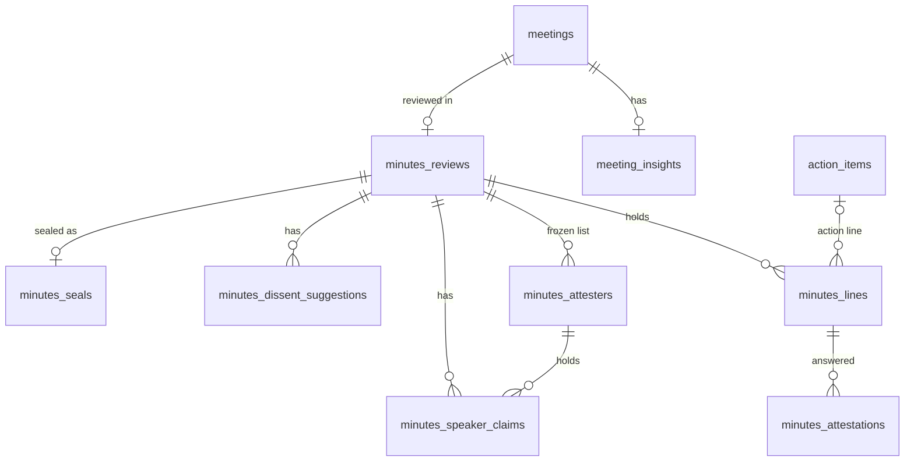

# 0003. Tasdeeq, Verified Minutes

**Status**: In Progress
**Date**: 2026-11-02
**Mode**: FEATURE
**Scope feature**: [docs/scope/scope.md, row 19. Tasdeeq, Verified Minutes](../../scope/scope.md)
**Workflow tier**: GA
**Build approach**: Extend, built as end to end slices
**Builds on**: [0001. Promise Ledger](../0001-promise-ledger/index.md) · [0002. Live Ledger](../0002-live-ledger/index.md)

## Summary

Tasdeeq (Urdu for "confirmation") turns the AI minutes into minutes the attendees have checked themselves. After a meeting, the owner opens a review. Every signed in attendee claims their speaker name, then confirms, corrects, or taps "Record my view" on the minutes lines that come from what they said. Each line shows the transcript lines behind it, and a line with no support is flagged.

When enough people have finished, or the deadline passes, the owner seals the minutes. Sealing takes a SHA-256 fingerprint (a short code that changes if even one letter changes) of everything that was confirmed, chains it to the owner's previous seal, and signs it with a server key. Anyone with the link can later check whether the minutes were changed after sealing. It reuses the one AI call that already runs, Resend, pdf-lib, and Node `crypto`, so it adds no paid service and no new provider. It is "tamper evident", never "legally binding".

## Requirements

### User stories

- As a meeting owner, you want to open a review of the AI minutes, so the record is checked by the people who were there and not only by you.
- As an attendee, you want to see the minutes lines that come from what you said, with the exact transcript lines behind them, so you can confirm or fix them quickly.
- As an attendee who disagreed, you want to record your view on a decision, so the minutes show that you did not agree, in your own words.
- As an attendee, you want the AI to point out where you may have objected, so you do not forget to record it.
- As a meeting owner, you want to seal the minutes once enough people confirmed or the deadline passed, so the record is final.
- As anyone holding the sealed fingerprint, you want to check that the minutes were not changed after sealing, without needing an account.
- As an evaluator, you want a planted error study, so the panel sees how many errors attendees catch compared with the host alone.

### Acceptance criteria

- **AC-1 Draft with evidence.** `POST /api/ai/process` writes `meeting_insights.minutes_draft` in the same run, from the same single structured AI call (no extra LLM call). The draft holds one line per summary point, key point, decision, and action item. Each line carries up to 2 verbatim quotes, and the server locates each with `findQuoteLines` (a new helper beside `findQuoteLine` that returns every matching line, same `MIN_QUOTE_CHARS` minimum) to get its 1 based line number and speaker. When a quote matches several lines, the first match whose speaker the model named for that line wins, else the first match. A quote that cannot be located, or that is located only past `coverage.lastLine`, is dropped. A line with no located quote is stored with `supported = false`. The `key_points` and `decisions` columns are still filled exactly as today.
- **AC-2 Coverage banner.** The draft stores `coverage = { lastLine, totalLines }`, where `lastLine` is the last transcript line the model saw (the 16000 character cap) and `totalLines` is the line count of the full `raw_text`. The Minutes tab always shows "These minutes cover transcript lines 1 to X of Y". The same text goes into the sealed bundle.
- **AC-3 AI dissent suggestions.** The same call returns up to 5 dissent suggestions (speaker label, topic, position, quote, optional related decision). A suggestion is kept only if any line matched by `findQuoteLines` (within `coverage.lastLine`) has a speaker whose label key equals the suggestion's label key; that line's number is stored. Others are dropped and counted in a `[tasdeeq]` log line.
- **AC-4 Draft visibility.** Before a review is open, `GET /api/minutes` returns the full draft only to the owner. A signed in user with an `attendance_events` row for the meeting gets `{ state: "not_open" }` and the tab shows "Minutes not open for review yet". Anyone else gets 404.
- **AC-5 Open review.** `POST /api/minutes/review` with `action: "open"` and `deadlineDays` of 3 or 7 (default 3) is owner only. It creates the `minutes_reviews` row, copies the draft lines into `minutes_lines` and the suggestions into `minutes_dissent_suggestions`, freezes the attester list into `minutes_attesters` (the owner plus every distinct `attendance_events.user_id` for the meeting that does not start with `guest-`), and stores the transcript source and the SHA-256 of `transcripts.raw_text`. It returns 409 if a review already exists, and 409 "Process the meeting first" if there is no draft.
- **AC-6 Deadline.** `deadline_at` is 23:59:59 Asia/Karachi on the Nth working day after the day the review opens (Saturday and Sunday skipped, the opening day not counted, no holiday calendar).
- **AC-7 Freeze.** While a review exists (open or sealed), `POST /api/ai/process` returns 409 and changes nothing, and so does any route that would write `transcripts.raw_text` for that meeting (`POST /api/transcript/upload` with that `meetingId`, transcript generation). Because processing runs a long AI call, the process route checks again right before its delete block and returns 409 if a review appeared meanwhile. While the review is open, the owner can `action: "cancel"`, which deletes the review and all its rows, after which processing works again. After the seal, cancel returns 409 and `DELETE /api/meetings/[id]` returns 409 "Sealed minutes can't be deleted" (a pre check, with the foreign key error from `on delete restrict` also mapped to the same 409). Deleting a meeting whose review is still open is allowed and removes the review and its answers; the delete confirm text warns about it.
- **AC-8 Speaker claims.** The tab lists every speaker label found in the transcript, read with the existing `speakerLabel()` from `src/agent/ledger.ts`. Labels made only of digits and punctuation (for example `10:30`) are excluded. Labels merge by a label key (lowercase, trimmed, inner spaces collapsed) and show their first seen spelling; claims are stored by label key. A label that equals an attester's `display_name` (case and space insensitive) is shown preselected for that attester, and only becomes theirs when they press Claim. `POST /api/minutes/claim`: `claim` (self, an unclaimed label), `assign` (owner, an unclaimed label to a `userId` that must be an attester, 422 otherwise), `clear` (owner, a claim whose holder has not answered any line from it). One holder per label; one person may hold several labels. A claim on a label already held returns 409. Clearing or assigning a claim whose holder already answered a line from it returns 409.
- **AC-9 Attribution.** A line is yours when any of its evidence speakers has the label key of one of your claims, or, for an action item, its assignee's label key equals one of your claimed label keys or your display name's key, or the assignee's first word equals the first word of one of those. A line with no evidence speaker and no matching assignee (including every unsupported line) belongs to the owner. Attribution is computed at read time, never stored.
- **AC-10 Attest.** `POST /api/minutes/attest` with `confirm`, `correct`, or `view`. Confirm and correct are allowed only on your attributed lines (422 otherwise). View is allowed on your attributed lines, on any decision line, and on any unsupported line. Correct and view need a note of 1 to 500 characters (422 otherwise). One answer per person per line; a new answer replaces the old one (latest wins). An answer saved after `deadline_at` is stored with `late = true`. A caller who is not an attester gets 403; any answer when the review is not open gets 409. The AI text of a line never changes; corrections are stored beside it.
- **AC-11 Suggestions.** A dissent suggestion is shown only to the holder of its speaker label. Adopting it (`attest` with `action: "view"` and `suggestionId`) saves a view on its related decision line (or on the decision line the user picks when there is none), prefilled with the suggestion's position, and marks it `adopted`. `POST /api/minutes/suggestion` with `dismiss` marks it `dismissed`. Neither is allowed for anyone else (403).
- **AC-12 Finish my review.** `attest` with `action: "finish"` sets your `done_at`. It returns 409 while any of your attributed lines has no answer from you. It works with zero attributed lines. The owner's lines include every unsupported or unlabeled line, so the owner answers those before finishing. A later claim or assign that gives you a label with unanswered lines clears your `done_at`.
- **AC-13 Seal rules.** `POST /api/minutes/seal` is owner only. It returns 409 with a reason when the owner has not finished their own review, or when quorum is not met and the deadline has not passed. Quorum is the owner plus more than half of the other attesters; with no other attesters, the owner alone is quorum. The seal first moves the review `open → sealing` with a conditional update, so no claim or answer can land while the bundle is built; two seal requests at once produce exactly one seal (the conditional update plus unique `review_id`), and the loser gets 409.
- **AC-14 Seal crypto.** The seal builds the canonical bundle (see *Seal bundle*), takes its SHA-256 (hex), includes the `content_sha256` of the owner's previous seal as `prev_seal_sha256` (null for the first), signs the canonical bytes with Ed25519 using `MINUTES_SIGNING_PRIVATE_KEY`, and stores signature, `key_id`, bundle, and status text in `minutes_seals` with `sealed_at` passed in explicitly (the same value as `bundle.sealedAt`), then sets the review `sealing → sealed`. If the key is missing or invalid, or any step fails, the review goes back to `open`, the route returns 500, nothing is sealed, and it logs `[tasdeeq]` (`signing key unavailable` for the key case).
- **AC-15 Honest status.** The seal stores a status text built by `buildStatusText`: "Confirmed by D of M." (D = attesters with `done_at` set, M = all attesters, owner included), then "N did not respond." when N = M − D is above 0, then "V recorded views, C corrections." counting `view` and `correct` answers (singular for 1, the clause left out when both are 0). Example: "Confirmed by 2 of 4. 2 did not respond. 1 recorded view, 1 correction." The sealed tab, the email, the PDF, and the verify page show it.
- **AC-16 Verify.** `GET /api/minutes/verify?sealId=` (public, no sign in) returns `intact` only when the bundle hash equals `content_sha256`, the signature verifies, the live `minutes_lines` and `minutes_attestations` still equal the bundle, and the live transcript hash equals the bundle's. Otherwise it returns `altered`. With `&hash=`, it also returns whether the pasted hash matches. It returns the hash, meeting title, meeting date, and status text, and never the minutes text. An unknown seal id returns 404. The page `/minutes/verify/[sealId]` shows the same, with a paste box for the hash, and its copy says the independent check is comparing against the hash you received by email or in the PDF.
- **AC-17 Emails.** Opening a review emails "Review open" (meeting title, deadline, link to the Minutes tab) to every attester except the owner. Sealing emails "Minutes sealed" (status text, hash, verify link) to every attester. Each email is sent once. A send failure is logged with `[tasdeeq]` and never blocks open or seal. An attester with no known email is skipped and logged.
- **AC-18 PDF.** `GET /api/minutes/pdf?meetingId=` is open to any attester after the seal (409 before). It returns `application/pdf` with every line, its section, its evidence line numbers, its supported flag, each attester's answer with notes (views labeled "Recorded view of NAME"), the coverage text, the status text, the hash, the verify URL, and the Urdu note when text had to be replaced.
- **AC-19 Honest Urdu labeling.** When `transcripts.source = 'recording'`, the tab and PDF show "Quotes are English translations of the recording". Urdu quote claims apply only to uploaded transcripts.
- **AC-20 Minutes tab.** A "Minutes" tab on meeting detail, visible to the owner and to recorded participants (not in `OWNER_ONLY_TABS`). States: not open (owner sees the draft and the open review control with a 3 or 7 day picker), open (claim, act on your lines, progress, Finish my review, owner Seal and Cancel), sealed (read only, hash, verify link, PDF). Every loading state uses `useLoadingTimeout` with `LoadError`.
- **AC-21 Evaluation.** `scripts/tasdeeq-seed.ts` plants K known errors (a misattributed line, a changed date, a dropped objection) into an open review's `minutes_lines` for a demo meeting and prints an answer key. `reports/tasdeeq-evaluation-template.md` records catch rate (Tasdeeq attendees versus the host alone), time to confirm, and dissent suggestion precision with Cohen's kappa. No LLM call in either.
- **AC-22 Zero cost.** No new provider, no paid service, no extra LLM call. Only the existing Gemini and Groq call, Supabase, Resend free tier, pdf-lib, and Node `crypto`.

## Decision

Extend the single existing extraction call to return quotes per minutes line and dissent suggestions, locate every quote on the server, and store the result as a draft. Opening a review copies the draft into rows that the attendees answer. The seal is a signed, chained SHA-256 of a canonical JSON bundle stored next to the live rows, so verification can detect both a changed bundle and changed live rows.

Runner up: a second AI call that grounds each minutes line after extraction. It would give cleaner evidence, but it doubles quota use on the free tier and adds a second failure point, while `findQuoteLine` already locates verbatim quotes reliably for the Promise Ledger.

Calls made in this spec (not asked):
- **Model output shape.** The model returns a new `minutes` object with `summaryPoints`, `keyPoints`, and `decisions` as `{ text, quotes }` lists, and each action item gains `quotes`. The server fills the existing `key_points` and `decisions` columns from the `text` values, so every current reader stays unchanged. Runner up: index aligned quote arrays beside the old string lists, which breaks silently when the model skips one.
- **Action item ids.** The route generates action item ids with `crypto.randomUUID()` before the inserts, so the draft (written with the insights insert) can carry each action line's real `action_item_id`. Runner up: a second update after the action items insert, which adds a write that can fail on its own.
- **Dissent suggestion link.** Each suggestion carries a nullable `relatedDecisionIndex`. Runner up: always asking the user to pick, which adds a step to the common case.
- **Verify scope.** Ledger item status changes after the seal are legitimate (a promise gets kept later), so ledger items and Live Ledger tallies are checked only inside the bundle hash, never against live rows.
- **Emails ignore the notifications toggle.** Review emails are part of the attestation itself, not reminders, so they are always sent when an email is known.
- **Answers are visible to all attesters.** During review, every attester sees every answer with the name beside it, since the sealed record shows them anyway.

**Implementation skills**: none beyond the project's own conventions (no Stream code is touched).

## Feature design

### Data model

Added to `supabase/schema.sql` in a `Tasdeeq` section, RLS on with no policies, `service_role` grants, same as the ledger tables.

```sql
alter table meeting_insights
  add column if not exists minutes_draft jsonb; -- null for meetings processed before Tasdeeq

create table if not exists minutes_reviews (
  id uuid primary key default gen_random_uuid(),
  meeting_id uuid unique references meetings(id) on delete cascade not null,
  status text not null default 'open' check (status in ('open', 'sealing', 'sealed')), -- cancel deletes the row
  deadline_days integer not null check (deadline_days in (3, 7)),
  deadline_at timestamptz not null,
  opened_at timestamptz not null default now(),
  coverage jsonb not null,                -- { lastLine, totalLines, text }
  transcript_source text not null check (transcript_source in ('upload', 'recording')),
  transcript_sha256 text not null
);

create table if not exists minutes_lines (
  id uuid primary key default gen_random_uuid(),
  review_id uuid references minutes_reviews(id) on delete cascade not null,
  position integer not null,
  section text not null check (section in ('summary', 'key_point', 'decision', 'action_item')),
  text text not null,
  evidence jsonb not null default '[]',   -- [{ quote, lineNumber, speaker }], at most 2
  supported boolean not null,
  speaker_labels text[] not null default '{}',
  action_item_id uuid references action_items(id) on delete set null,
  assignee text,
  unique (review_id, position)
);

create table if not exists minutes_attesters (
  review_id uuid references minutes_reviews(id) on delete cascade not null,
  user_id text not null,                  -- Clerk id
  display_name text not null,
  email text,
  is_owner boolean not null default false,
  done_at timestamptz,
  primary key (review_id, user_id)
);

create table if not exists minutes_speaker_claims (
  review_id uuid references minutes_reviews(id) on delete cascade not null,
  speaker_label text not null,           -- the label key (lowercase, trimmed, spaces collapsed)
  display_label text not null,           -- first seen spelling
  user_id text not null,
  claimed_by text not null check (claimed_by in ('self', 'owner')),
  claimed_at timestamptz not null default now(),
  primary key (review_id, speaker_label),
  foreign key (review_id, user_id) references minutes_attesters(review_id, user_id) on delete cascade
);

create table if not exists minutes_attestations (
  line_id uuid references minutes_lines(id) on delete cascade not null,
  user_id text not null,
  action text not null check (action in ('confirm', 'correct', 'view')),
  note text check (note is null or char_length(note) between 1 and 500),
  late boolean not null default false,
  updated_at timestamptz not null default now(),
  primary key (line_id, user_id),
  check (action = 'confirm' or note is not null)
);

create table if not exists minutes_dissent_suggestions (
  id uuid primary key default gen_random_uuid(),
  review_id uuid references minutes_reviews(id) on delete cascade not null,
  speaker_label text not null,
  topic text not null,
  position text not null,
  quote text not null,
  line_number integer not null,
  related_line_id uuid references minutes_lines(id) on delete set null,
  status text not null default 'suggested' check (status in ('suggested', 'adopted', 'dismissed'))
);

create table if not exists minutes_seals (
  id uuid primary key default gen_random_uuid(),
  review_id uuid unique references minutes_reviews(id) on delete restrict not null,
  meeting_id uuid references meetings(id) on delete restrict not null,
  owner_id text not null,
  content_sha256 text not null,
  prev_seal_sha256 text,
  signature text not null,                -- base64 Ed25519
  key_id text not null,
  bundle jsonb not null,
  status_text text not null,
  sealed_at timestamptz not null default now()
);
create index if not exists minutes_seals_owner_idx on minutes_seals (owner_id, sealed_at desc);
```

`on delete restrict` on `minutes_seals` is the database backstop for AC-7: even a cascade delete of the meeting fails once sealed.



### Draft shape (`minutes_draft`)

```ts
type MinutesDraft = {
  version: 1;
  lines: Array<{
    section: "summary" | "key_point" | "decision" | "action_item";
    text: string;
    evidence: Array<{ quote: string; lineNumber: number; speaker: string | null }>;
    supported: boolean;
    speakerLabels: string[];      // distinct non null evidence speakers
    actionItemId: string | null;  // action_item lines only
    assignee: string | null;      // action_item lines only
  }>;
  dissentSuggestions: Array<{
    speakerLabel: string; topic: string; position: string;
    quote: string; lineNumber: number; relatedDecisionIndex: number | null;
  }>;
  coverage: { lastLine: number; totalLines: number };
};
```

Lines are ordered: summary points, key points, decisions, action items. `position` at open is the array index.

### Model output change (`src/agent/types.ts`)

All new fields use `.nullable()`, never `.optional()`.
- `minutes: { summaryPoints, keyPoints, decisions }`, each a list of `{ text: string, speakers: string[] | null, quotes: string[] | null }` (at most `MINUTES_MAX_QUOTES` quotes, and at most 6 summary points, 8 key points, 8 decisions; extras are cut on the server). `speakers` is only the model's hint for picking among repeated matches. `insights.summary` stays a paragraph and is produced as today; summary points are new and live only in the draft.
- `actionItems[].quotes: string[] | null`.
- `dissentSuggestions: Array<{ speakerLabel, topic, position, quote, relatedDecisionIndex: number | null }> | null`.
- `insights.keyPoints` and `insights.decisions` are removed from the model output; the route fills those columns from `minutes.keyPoints[].text` and `minutes.decisions[].text`.
- If both providers fail, the route fails exactly as it does today (no partial draft).
- `meetingInsightsSchema` is a model schema only. The DB shaped `MeetingInsights` type stays separate and unchanged, so UI readers keep working.
- The prompt keeps today's transcript format and adds: quotes must be copied word for word from one transcript line, including no speaker name; return no quote rather than invent one.

Pure helpers go in `src/agent/minutes.ts`: `buildMinutesDraft({ result, rawText, actionItemIds })`, `computeCoverage(rawText, maxChars)`, `attributedLineIds(lines, claims, attester)`, `computeDeadline(openedAt, days)`, `quorumMet(attesters)`, `buildStatusText(...)`, `canonicalJson(value)`, `buildSealBundle(...)`.

### State transitions

```
review: (no row) --open--> open --seal starts--> sealing --seal done--> sealed
                     sealing --seal fails--> open
                     open --cancel--> (no row)
attester: pending --finish--> done --new unanswered claim--> pending   (only while open)
suggestion: suggested --adopt--> adopted
            suggested --dismiss--> dismissed
```

Every `minutes_*` mutation is conditional on the review being `open` (for example `.eq("status", "open")`, or an insert that first rereads the status in the same request and a conditional update after), so a request racing a seal or cancel changes nothing and returns 409. `sealing` blocks every mutation except the seal route itself.

### API contracts (add to AGENTS.md before coding)

```
GET  /api/minutes                 → owner or recorded participant: ?meetingId=, draft (owner, before open) or review state, lines, evidence, claims, my answers, all answers, my suggestions, progress, seal
POST /api/minutes/review          → owner only: { meetingId, action: "open" | "cancel", deadlineDays?: 3 | 7 }, open freezes lines and attesters and sends "Review open" emails
POST /api/minutes/claim           → attester: { meetingId, action: "claim" | "assign" | "clear", speakerLabel, userId? (assign) }, assign and clear are owner only
POST /api/minutes/attest          → attester: { meetingId, action: "confirm" | "correct" | "view" | "finish", lineId?, note?, suggestionId? }, latest answer wins, late flagged
POST /api/minutes/suggestion      → holder of the label: { meetingId, suggestionId, action: "dismiss" }
POST /api/minutes/seal            → owner only: { meetingId }, signed chained SHA-256 seal, sends "Minutes sealed" emails
GET  /api/minutes/verify          → public: ?sealId= (&hash=), intact or altered, hash, title, date, status text, never the minutes text
GET  /api/minutes/pdf             → attester, after seal: ?meetingId=, application/pdf with Content-Disposition attachment
POST /api/ai/process              → (extended) also writes minutes_draft; 409 while a minutes review exists
POST /api/transcript/upload       → (extended) 409 when meetingId has a minutes review
POST /api/transcript/download     → (extended) 409 when generation would rewrite a transcript under a minutes review
DELETE /api/meetings/[id]         → (extended) 409 "Sealed minutes can't be deleted" when sealed
```

| Endpoint | Method | Key inputs | Key outputs | Auth | Key errors |
|---|---|---|---|---|---|
| /api/minutes | GET | meetingId (req) | state, lines, claims, answers, progress, seal | owner or participant | 401, 404 |
| /api/minutes/review | POST | meetingId, action, deadlineDays | review id, deadlineAt | owner | 404, 409 exists or no draft or sealed, 422 days |
| /api/minutes/claim | POST | meetingId, action, speakerLabel, userId | claims | attester; assign and clear owner | 403, 409 taken or locked or not open |
| /api/minutes/attest | POST | meetingId, action, lineId, note, suggestionId | my answer, doneAt | attester | 403, 409 not open or unanswered lines, 422 note or not yours |
| /api/minutes/suggestion | POST | meetingId, suggestionId, action | status | label holder | 403, 409 |
| /api/minutes/seal | POST | meetingId | sealId, hash, statusText | owner | 409 not done or no quorum or sealed, 500 key |
| /api/minutes/verify | GET | sealId (req), hash (opt) | result, hashMatches, hash, title, date, statusText | public | 404 |
| /api/minutes/pdf | GET | meetingId | PDF | attester | 403, 404, 409 not sealed |

Error shape everywhere: `{ error: string }`. Access order: 401 signed out, 404 when the meeting is not found or the caller is neither owner nor recorded participant (before open) nor attester (after open), 403 when the caller is known but not allowed this action. Every failure logs with `[tasdeeq]`.

### Seal bundle

```ts
type SealBundle = {
  version: 1;
  meeting: { id: string; title: string; date: string };   // date = started_at or created_at, YYYY-MM-DD
  review: { id: string; openedAt: string; deadlineAt: string; deadlineDays: 3 | 7 };
  transcript: { source: "upload" | "recording"; sha256: string };
  coverageText: string;
  lines: Array<{ id; position; section; text; evidence; supported; speakerLabels; assignee }>;
  attesters: Array<{ userId; displayName; isOwner; doneAt: string | null }>;
  claims: Array<{ speakerLabel; userId; claimedBy }>;
  attestations: Array<{ lineId; userId; action; note: string | null; late: boolean }>;
  ledgerItems: Array<{ id; kind; statement; quote; assignee; dueDate; status; source }>; // this meeting's ledger_items
  liveAgreements: Array<{ statement; agreed: number; total: number;
                          votes: Array<{ voterName: string; vote: "agree" | "not_yet" }> }>;
  statusText: string;
  prevSealSha256: string | null;
  sealedAt: string;
};
```

- `canonicalJson` sorts object keys recursively, writes no spaces, and keeps arrays in a fixed order: lines by `position`, attesters and claims by `userId` then label, attestations by line position then `userId`, ledger items by `line_number` then id, agreements by `opened_at`. The hash is SHA-256 hex of its UTF-8 bytes.
- Voter names come from `minutes_attesters.display_name`, else the latest `attendance_events.participant_name` for that id, else "Guest".
- The signature is `crypto.sign(null, canonicalBytes, privateKey)` as base64. Verify derives the public key with `crypto.createPublicKey(privateKey)`.

### Verify logic (`verifySeal(sealId, pastedHash?)` in `src/lib/minutes-seal.ts`, server only)

1. Load the seal; none → 404.
2. `sha256(canonicalJson(bundle)) === content_sha256`, else altered.
3. `key_id === MINUTES_SIGNING_KEY_ID` and the signature verifies, else altered. A key id mismatch logs `[tasdeeq] seal signed with retired key` and returns `altered` with `reason` kept server side only.
4. Rebuild the lines, attestations, claims, and attesters part from live rows and compare with the bundle; any difference → altered.
5. `sha256(transcripts.raw_text) === bundle.transcript.sha256`, else altered.
6. `hashMatches = pastedHash ? pastedHash.trim().toLowerCase() === content_sha256 : null`.

The page `src/app/minutes/verify/[sealId]/page.tsx` is a server component that calls `verifySeal` directly. It is not added to `isPublicRoute` (that would redirect signed in users to the dashboard) and not to `isProtectedRoute`, so everyone can reach it.

### UI

- `src/components/meeting-intelligence/MinutesTab.tsx` added to `MeetingTabs.tsx` (not owner only).
- Before open (owner): the draft grouped by section, each line with its evidence quotes and line numbers, an "Unsupported" badge on unsupported lines, the coverage banner, and "Open review" with a 3 or 7 working day picker. Others: "Minutes not open for review yet".
- During review: a "Your speaker name" strip (suggested label, Claim button, owner assign and clear), your lines first with Confirm, Correct, Record my view; other decision lines with Record my view; the transcript line text beside each quote; your private suggestions with Adopt and Dismiss; progress "D of M finished, deadline DATE"; Finish my review. Owner also sees Seal (disabled with the reason) and Cancel review (with a confirm step).
- Sealed: read only lines and answers, status text, hash with copy, verify link, Download PDF.
- Light app tokens only, no hex, no raw Tailwind colors. Every fetch uses `useLoadingTimeout` + `LoadError`.

### Value sourcing

| Action | Value produced / displayed | Source |
|---|---|---|
| process | minutes lines and quotes | the existing structured call (`minutes`, `actionItems[].quotes`) |
| process | line number, speaker per quote | `findQuoteLine(raw_text, quote)` |
| process | supported | derived: at least one located quote |
| process | action line id | `crypto.randomUUID()` generated before the action items insert |
| process | coverage lastLine | line count of `raw_text.slice(0, MAX_TRANSCRIPT_CHARS)` split like `findQuoteLine`, minus 1 when the cut lands inside a line |
| process | coverage totalLines | `raw_text.split(/\r?\n/u).length` (blank lines counted, the same numbering the UI shows) |
| open | attesters | `meetings.user_id` + distinct non null `attendance_events.user_id` not like `guest-%` |
| open | display name (frozen, never refreshed) | latest `attendance_events.participant_name` for that user, else Clerk `firstName lastName`, else "Attendee" (Clerk failure logged, open continues) |
| open | email | Clerk `clerkClient().users.getUser(id)` primary email, else `attendance_events.participant_email`, else null |
| open | deadline_at | `computeDeadline(now, deadlineDays)` in Asia/Karachi (UTC+5, no daylight saving) |
| open | transcript source and hash | `transcripts.source`, `sha256(transcripts.raw_text)` |
| GET | speaker labels | `speakerLabel()` per `raw_text` line, digit only labels excluded, merged by label key, first seen spelling shown, at most 60 characters |
| GET | suggested label | label whose key equals the key of `minutes_attesters.display_name` |
| GET | attributed lines | `attributedLineIds` at read time (AC-9) |
| GET | quorum, can seal | `quorumMet(attesters)`, owner `done_at`, `now() >= deadline_at` |
| attest | late | `now() > deadline_at` |
| seal | prev hash | `content_sha256` of the owner's latest `minutes_seals` row by `sealed_at` |
| seal | ledger items | `ledger_items` where `meeting_id` = this meeting |
| seal | live tallies | `ledger_agreements` (closed) + `ledger_agreement_votes` for this meeting |
| seal | status text | `buildStatusText(attesters, attestations)`, template in AC-15 |
| seal, verify | key | `MINUTES_SIGNING_PRIVATE_KEY`, `MINUTES_SIGNING_KEY_ID` |
| emails, PDF | verify URL | `${NEXT_PUBLIC_BASE_URL}/minutes/verify/${sealId}` |
| PDF | Urdu note | shown when `toPdfSafe` replaced any character pdf-lib's standard font cannot draw |

### Key invariants

- The AI text of a minutes line never changes after the review opens. Corrections and views live in `minutes_attestations`.
- A meeting has at most one review and at most one seal (unique `meeting_id`, unique `review_id`).
- A speaker label has at most one holder per review.
- Nothing writes `meeting_insights`, `action_items`, or `transcripts.raw_text` for a meeting with a review. `assertMinutesUnlocked(meetingId)` in `src/lib/minutes-lock.ts` is the single check every such route calls.
- A sealed review never returns to open, and its rows are never written again. Attester names and emails are frozen at open.
- Ledger status can change after the seal; only the bundle snapshot is sealed.

### Security model

- All reads and writes go through API routes with the Supabase service role client. Tables have RLS on with no policies.
- Ownership is `meetings.user_id`. Attester status is the frozen `minutes_attesters` row, never a client value. Guests cannot attest (no Clerk id).
- `MINUTES_SIGNING_PRIVATE_KEY` is server only, like the other secrets in AGENTS.md. It never appears in a response, a log, or the bundle.
- The verify route is public but returns only the result, the hash, the meeting title and date, and the status text. Seal ids are random uuids. No rate limiter is added (no free shared store on serverless); the read is cheap and leaks no minutes text. See Follow-up.
- The verify route shows the meeting title and date to anyone holding a seal link. This is accepted: titles are low risk and seal ids are unguessable.
- `minutes_attesters.email` is stored only to send the two emails and is deleted with the meeting (sealed meetings keep it while they exist).
- Minutes text and notes may hold personal views. They are shown only to attesters and the owner, and are emailed to nobody (emails carry only the title, deadline, status text, hash, and links).

### Configuration required

- `MINUTES_SIGNING_PRIVATE_KEY`: Ed25519 private key, PKCS8 PEM (newlines written as `\n`), server only. Generate once with `openssl genpkey -algorithm ed25519`.
- `MINUTES_SIGNING_KEY_ID`: a short label for that key (for example `tasdeeq-2026-11`), stored on every seal so a future rotation is visible.

### Critical test scenarios

- Happy path: process, open with 3 days, two attesters claim, confirm, correct, record a view, finish, owner seals, verify returns intact, PDF downloads, verifies **AC-1**, **AC-5**, **AC-10**, **AC-12**, **AC-14**, **AC-16**, **AC-18**.
- A quote not found in the transcript: the line is stored unsupported, verifies **AC-1**.
- A suggestion whose quote is from another speaker: dropped, verifies **AC-3**.
- Reprocess during review: 409, insights unchanged. Cancel, reprocess works. Delete a sealed meeting: 409, verifies **AC-7**.
- Two users claim the same label at once: one wins, the other 409. Owner clears a label after its holder answered: 409, verifies **AC-8**.
- Confirm on a line that is not yours: 422. View on any decision: 200. Answer after the deadline: `late = true`, verifies **AC-9**, **AC-10**.
- Finish with an unanswered line: 409. Claim a new label after finishing: `done_at` cleared, verifies **AC-12**.
- A process run that started before open finishes after open: 409 at the second check, nothing rewritten, verifies **AC-7**.
- A repeated short phrase said by two speakers: evidence picks the speaker the model named, verifies **AC-1**.
- An answer sent while the seal is building: 409, and verify right after the seal returns intact, verifies **AC-13**, **AC-16**.
- Two seal requests at once: one seal, one 409. Seal without quorum before the deadline: 409. Seal with the key unset: 500, review still open, verifies **AC-13**, **AC-14**.
- Edit a `minutes_attestations.note` in the database after the seal: verify returns altered. Change a ledger item status: still intact, verifies **AC-16**.
- Resend failing: open and seal still succeed, failure logged, verifies **AC-17**.
- Deadline opened on Friday with 3 days: ends Wednesday 23:59:59 PKT, verifies **AC-6**.
- A non attester signed in user calls attest: 403. A stranger calls GET: 404. Signed out verify call: 200, verifies **AC-4**, **AC-10**, **AC-16**.

### Constants

`MINUTES_MAX_QUOTES = 2`, `MINUTES_MAX_SUMMARY_POINTS = 6`, `DISSENT_SUGGESTIONS_MAX = 5`, `MINUTES_NOTE_MAX = 500`, `MINUTES_DEADLINE_DAYS = [3, 7]` (default 3), `MINUTES_TZ = "Asia/Karachi"`, `SPEAKER_LABEL_MAX = 60`, `MINUTES_MAX_KEY_POINTS = 8`, `MINUTES_MAX_DECISIONS = 8`.

## Build plan

Each slice ends with something you can see working on a real processed meeting.

1. [x] **T1, schema plus draft with evidence.** First grep every user of `meetingInsightsSchema`, `extractionResultSchema`, and `MeetingInsights` and list the files the change touches. Migration for all tables and the `minutes_draft` column. Add `findQuoteLines` to `src/agent/ledger.ts`. Extend `extractionResultSchema` and the process prompt, generate action item ids, write `minutes_draft` with located quotes, coverage, and validated suggestions, fill `key_points` and `decisions` from the new shape, update `route.test.ts`. `GET /api/minutes` for the not open state and `MinutesTab` showing the owner's draft with evidence, unsupported badges, and the coverage banner. Satisfies **AC-1**, **AC-2**, **AC-3**, **AC-4**, **AC-19**, **AC-20**.
2. [x] **T2, open, cancel, freeze, claims.** `POST /api/minutes/review` (open with attester freeze and deadline, cancel), `assertMinutesUnlocked` in process, transcript upload, transcript generation, and meeting delete, `POST /api/minutes/claim`, the claim strip in the tab, "Review open" email. Satisfies **AC-5**, **AC-6**, **AC-7**, **AC-8**, **AC-17**, **AC-20**.
3. [x] **T3, attest, suggestions, finish.** `POST /api/minutes/attest`, `POST /api/minutes/suggestion`, attribution at read time, the action buttons, notes, suggestions panel, progress, Finish my review. Satisfies **AC-9**, **AC-10**, **AC-11**, **AC-12**, **AC-20**.
4. [x] **T4, seal and verify.** `src/lib/minutes-seal.ts` (canonical JSON, bundle, sign, verify), `POST /api/minutes/seal`, `GET /api/minutes/verify`, the `/minutes/verify/[sealId]` page, sealed tab state, "Minutes sealed" email, env vars in `.env.example`. Satisfies **AC-13**, **AC-14**, **AC-15**, **AC-16**, **AC-17**, **AC-20**.
5. [x] **T5, PDF.** `GET /api/minutes/pdf` with pdf-lib, following `src/app/api/attendance/report/route.ts`, plus `toPdfSafe` and the Urdu note. Satisfies **AC-18**, **AC-19**.
6. [x] **T6, evaluation plus end to end check.** `scripts/tasdeeq-seed.ts`, `reports/tasdeeq-evaluation-template.md`, a three person run (owner plus two signed in attendees, one uploaded bilingual transcript), and a check that no new dependency or provider was added. Satisfies **AC-21**, **AC-22**.

## Consequences

**Positive**
- The minutes become a record the attendees checked, with proof per line, which none of the meeting apps or AI notetakers we reviewed offer.
- One AI call still does everything, so the free tier quota cost barely moves (more output tokens, no extra request).
- Any change after sealing, including a direct database edit, shows up as "Altered after sealing".

**Negative / tradeoffs**
- Once a review opens, the meeting's insights, action items, and transcript are frozen. Fixing an AI mistake means cancelling the review (losing answers) or recording it as a correction.
- A sealed meeting can never be deleted through the app. A real deletion request needs a manual database step that will itself show as altered on verify.
- Verification trusts the server: the server holds the key and does the check. It is tamper evident against later edits, not proof against the operator. Say "tamper evident", never "legally binding".
- The extraction output grows (quotes per line, suggestions), so the call takes a little longer and the Groq fallback can hit its output limit sooner on long transcripts.
- Lines past the 16000 character cap get no minutes; the coverage banner says so instead of hiding it.
- Guests cannot attest, and an upload only meeting has the owner as the only attester. The status text says this honestly.
- Recorded transcripts are cleaned to English, so evidence for Urdu speech is a translation.

**Neutral**
- Meetings processed before this feature have no draft; the owner reprocesses once to get one.
- The owner's seal chain can fork if two seals run at the same moment on different meetings; each seal still verifies on its own.

## Follow-up

- [x] Add the routes above to the AGENTS.md API Contracts list (via `/sync`) before coding T2.
- [ ] Add `MINUTES_SIGNING_PRIVATE_KEY` and `MINUTES_SIGNING_KEY_ID` to `.env.local`, `.env.example`, and Vercel, and to the AGENTS.md never expose list.
- [ ] Run `npm run check:providers` after T1 and check that the longer output stays inside the Gemini and Groq free limits on a 16000 character transcript.
- [ ] Consider a light rate limit on `GET /api/minutes/verify` if abuse appears (no free shared store today).
- [ ] Key rotation: today a retired key makes old seals read as altered. If you ever rotate, add a list of retired public keys first.
- [ ] Run the planted error study and fill the evaluation template before the FYP demo.

## Rationale

Reasoning and options: see [rationale.md](rationale.md).
